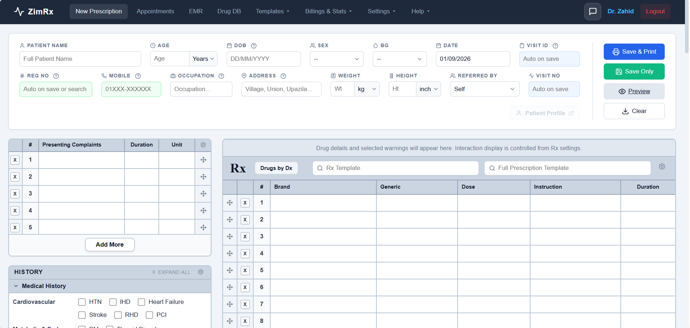

<p align="center">
  
</p>

<h1 align="center">ZimRx</h1>

<p align="center">
  <b>Privacy-First, Local-First Medical & Healthcare Suite</b><br>
  <i>Built for solo physicians, medical practitioners, and clinics in low-resource and low-connectivity regions.</i>
</p>

<p align="center">
  <a href="https://github.com/aliffarzanzim/zimrx/actions/workflows/tests.yml"></a>
  <a href="https://www.gnu.org/licenses/agpl-3.0"></a>
  <a href="#data-sovereignty--patient-rights"></a>
  <a href="https://www.php.net/"></a>
  <a href="https://frankenphp.dev/"></a>
</p>

---


*A preview of the ZimRx ultra-fast Prescription Grid UI*

**Prototype Demo**: [Watch the Prototype Video (preview/prototype-preview.mp4)](preview/prototype-preview.mp4) - *Demonstration of the doctor-friendly, ultra-fast prescription workflow.*

---

**ZimRx** is an open-source, privacy-first, local-first, high-performance Medical & Healthcare Suite for solo doctors, medical practitioners, and clinics in low-resource or bandwidth-constrained regions. Designed for fully air-gapped and offline environments with zero external network dependencies, it eliminates recurring SaaS subscription costs and guarantees complete patient data privacy and sovereignty.

---

## The Three Cardinal Laws of ZimRx

**LAW 1: IF IT CANNOT RUN AIR-GAPPED, IT DOES NOT ENTER ZIMRX.**  
Zero Cloud. Zero Telemetry. Zero Data Loss.

**LAW 2: NEVER BLOCK THE CLINICIAN.**  
No Spinners. No Loading Bars. Zero Keystroke Latency.

**LAW 3: BETTER INCOMPLETE THAN WRONG.**  
Never Guess. Never Fabricate. Zero Silent Assumptions.

---

## Key Features

### Prescribing & EMR
* **Ultra-Fast Grid UI**: Pure Vanilla JS and CSS tokens. Keyboard-driven (Tab, Ctrl, Shift & Arrow navigation) to eliminate mouse fatigue and compose prescriptions in under 30 seconds.
* **Sub-Millisecond Search**: Fast full-text lookup across 30,000+ national commercial drug brands and generic equivalents powered by SQLite FTS5.
* **Rapid Clinical Workflow**: Integrated modules for presenting complaints, vitals, medical history, physical exams, investigations, and patient advice templates.
* **Pixel-Perfect Print Engine**: Customizable prescription layout supporting custom doctor headers, clinic logos, multi-column formats, and print watermarks for A4/A5 or thermal printers.
* **Multi-Language Clinical Localization**: Patient instructions, dosage regimens, durations, and advice categories localized via simple JSON catalogs (`application/locales/`) with zero database migrations.

### Practice Management
* **Appointments & Queue Management**: Daily patient scheduling, waiting room queues, token/serial assignment, and automated consult slot time estimation.
* **Billing & Receipts**: Track consultation fees, generate itemized receipts, and manage clinic invoices with zero third-party accounting dependencies.
* **Role-Based Practice Access**: Support for solo practitioners, multi-doctor clinics, and assistant/receptionist intake accounts.

### Global Standards
* **WHO ATC, DDD & INN Standards**: Mapped to official WHO ATC 2026 classification (7,000 nodes), WHO Defined Daily Doses (2,700+ DDDs), and WHO/WCO International Nonproprietary Names (7,200+ INNs).
* **Clinical Decision Support (Assistive & In Development)**: Informational screening aids for drug-drug interactions, pediatric growth curves (WHO/CDC), and dosing parameters sourced from standard prescribing literature.
* **Decoupled Formularies**: Switch effortlessly between Dual Mode (Brand + Generic) and Generic-Only Mode depending on regional formulary availability.

---

## Data Sovereignty & Patient Rights

Patient health records should **never** be monetized, tracked, or leaked to centralized third-party clouds. ZimRx operates on strict principles of user and patient data sovereignty:

* **Zero Cloud Lock-in**: All patient encounters, appointments, and billing data stay strictly inside `application/userdata/` on local hardware.
* **Zero Telemetry**: No tracking pixels, no analytics backdoors, and no remote surveillance.
* **Guaranteed "Right to Exit"**: Patient clinical records can be exported in open international standards (HL7 FHIR International Patient Summary JSON, printable PDF summaries, and standard SQLite tables). Practitioners are never held hostage to proprietary binary formats.
* **Local Data Ownership**: Because all clinical records reside exclusively in the local database (`application/userdata/`), practitioners retain complete physical sovereignty over their records without cloud provider retention policies.
* **Frugal Computing & Hardware Longevity**: Engineered with zero heavy runtime bloatwares, allowing full deployment on fanless mini-PCs, Raspberry Pi units, or even in a 10-year-old clinic laptops. This counters planned obsolescence and supports rural and remote clinics powered by solar micro-grids.
* **Abrupt Power Cut & Load-Shedding Fault Tolerance**: In rural health posts and district outpatient clinics across the Global South, electrical grids experience frequent, unannounced load-shedding. ZimRx configures all SQLite connections in Write-Ahead Logging (`WAL`) mode with atomic ACID transaction boundaries: committed patient records and visit saves are immune to database corruption during sudden outages, while client-side draft auto-recovery is slated for the active prescribing roadmap.
* **Permanent Software Commons (AGPL-3.0-or-later)**: Enforces network copyleft to prevent commercial closed-source SaaS re-enclosure of publicly funded healthcare software.
* **The Right to be Forgotten (Planned Specification)**: When a patient requests complete profile erasure, the planned design targets genuine physical deletion rather than superficial soft-deletes:
  * **Physical Database Shredding**: Replacing superficial soft-deletes (`deleted_at` flags) with cascading deletions across encounters, vitals, and attachments, followed by database page-zeroing compaction (`VACUUM`) to prevent forensic recovery.
  * **Signed Request & Medico-Legal Defense**: A printable "Request for Record Erasure" form for physical patient signature, paired with a timestamped local audit log entry (`PATIENT_ERASURE_FULFILLED`) to protect clinicians against malpractice disputes.
  * **Certificate of Erasure**: A verifiable confirmation slip specifying the exact purge timestamp, anonymized reference, and zeroed record counts as permanent proof of erasure for the patient.

---

## Quick Start

ZimRx is designed for immediate deployment with zero build steps. Choose the launch method that fits your environment:

### Method 1: Portable Startup Script

ZimRx includes native launch scripts that automatically initialize local directories, seeds, verify runtime availability, and launch the web server on port `8080`:

* **Linux & macOS**:
  ```bash
  chmod +x start.sh
  ./start.sh
  ```
* **Windows**:
  Double-click or execute **`start.bat`**

Once started, open **`http://localhost:8080`** in your browser.

---

### Method 2: Native PHP CLI

If you already have PHP installed on your operating system:

#### 1. Required PHP Version & Extensions
ZimRx requires **PHP 8.2+** with the following standard extensions enabled:
* `pdo_sqlite` (local database engine)
* `mbstring` (multilingual UTF-8 processing)
* `fileinfo` (secure MIME-type validation for patient uploads)

#### 2. Package Installation Commands
* **Debian / Ubuntu / Raspberry Pi OS**:
  ```bash
  sudo apt update
  sudo apt install php8.2-cli php8.2-sqlite3 php8.2-mbstring php8.2-fileinfo
  ```
* **Fedora / RHEL**:
  ```bash
  sudo dnf install php-cli php-pdo php-sqlite3 php-mbstring
  ```
* **Alpine Linux**:
  ```bash
  apk add php82 php82-pdo_sqlite php82-mbstring php82-fileinfo
  ```
* **macOS (Homebrew)**:
  ```bash
  brew install php
  ```

#### 3. Recommended `php.ini` config
Ensure your `php.ini` contains appropriate limits for clinical file uploads and patient report attachments:
```ini
memory_limit = 256M
upload_max_filesize = 20M
post_max_size = 25M
max_execution_time = 60
```

#### 4. Launch the Server
```bash
php -S localhost:8080 -t application/public
```
Open **`http://localhost:8080`** in your browser.

---

### Method 3: Docker

```bash
# Build and launch FrankenPHP container
docker compose up -d

# Run automated tests inside the container
docker compose exec zimrx php application/tests/run_tests.php
```
Open **`http://localhost:8080`** in your browser. All clinical encounters, uploads, and databases are automatically persisted in the `zimrx_userdata` Docker volume.

---

### Method 4: Web Server (Caddy, Nginx, Apache)

ZimRx can be deployed on standard web servers or shared hosting environments:

1. Ensure PHP 8.2+ is configured (e.g. via PHP-FPM or FastCGI) with the required extensions enabled: `pdo_sqlite`, `mbstring`, and `fileinfo`.
2. Configure your virtual host document root to point strictly to `application/public/`. Internal directories (`application/userdata/`, `application/systemdata/`, `application/lib/`) must remain outside the exposed web root.
3. Ensure `application/userdata/` is writable by the web server process user (e.g. `www-data` or `nginx`).
4. On first browser visit, ZimRx automatically compiles master clinical reference catalogs from seeds and provisions the local doctor database in-process via PHP PDO. No external CLI database tools or SSH access are required.

---

## Project Structure

```text
zimrx/
├── application/
│   ├── public/       # Exposed web root (index.php, prescription.php, assets, api)
│   ├── userdata/     # Local database vaults, backups, uploads (strictly blocked from web access)
│   ├── systemdata/   # Master drug and clinical reference databases (ATC/DDD/INN)
│   ├── lib/          # Database connection, auth, and clinical business logic
│   ├── views/        # Clinical workspace modules and patient templates
│   └── locales/      # Multi-language clinical catalogs (en, bn)
├── tools/            # Offline dataset tools (growth charts, geo studio, catalog generators)
├── Caddyfile         # Caddy / FrankenPHP server configuration
├── start.bat         # Windows one-click startup script
└── start.sh          # Linux and macOS one-click startup script
```

---

## Development & Testing

ZimRx is built with a zero-build-pipeline philosophy: 100% Vanilla ES6+ JavaScript and modern CSS design tokens. No Node.js, npm, or transpilation tools are needed to develop or contribute.

### Automated Test Suite
ZimRx includes an automated regression test suite covering security controls, static source integrity, SQLite concurrency, and clinical calculations:

```bash
# Run the test suite:
php application/tests/run_tests.php

# Verify pediatric growth reference tables and Cole's LMS transformations:
php tools/growth-chart/fetch_and_build_reference_json.php --verify
```

### Reference Database Auto-Provisioning & Seeds
Master reference databases (`zimrx_drugs.db` and `zimrx_static.db`) are compiled directly from plain-text SQL seeds (`application/systemdata/seeds/*.sql`) using native PHP PDO. Compilation occurs automatically on first application launch, or can be triggered manually via CLI:
```bash
# Verify or compile reference databases (skips if healthy databases already exist)
php application/systemdata/seeds/build_db.php

# Force recompilation from seeds
php application/systemdata/seeds/build_db.php --force
```

### Database Schema Migrations
Doctor user database schemas (`application/userdata/database/zimrx_userdata.db`) and versioning are managed through `DbMigrator` (`application/lib/db/db_migrator.php`). Pending schema migrations are applied automatically on boot or can be checked via CLI:
```bash
php -r "require_once 'application/lib/db/db.php';"
```

### Offline Dataset Studios (`tools/`)
ZimRx includes standalone offline developer tooling for maintaining reference datasets without cloud or build dependencies:
* **Drug Studio** (`tools/drug-studio/`): Compiles pharmaceutical formularies, commercial brand catalogs, and WHO ATC/DDD/INN taxonomies.
* **Locale Studio** (`tools/locale-studio/`): Visual editor for translating clinical phrase templates, dosage regimens, and multilingual search aliases.
* **Geo Studio** (`tools/geo-studio/`): Compiles administrative boundaries, postal codes, and regional healthcare facility hierarchies.
* **Growth Chart Engine** (`tools/growth-chart/`): Generates WHO and CDC Cole's LMS reference tables and pediatric Z-score curves.

For detailed coding standards, security requirements, and guidelines on contributing new national formularies or language catalogs, see **[CONTRIBUTING.md](CONTRIBUTING.md)**.

---

## Global & Regional Adaptability

ZimRx is designed to be deployed across international clinics, cross-border health networks, and humanitarian crisis zones without code changes:

* **Decoupled Formularies (Drug Studio)**: Generic substances are mapped to WHO ATC 2026 and INN standards. International clinics can prescribe in universal generic mode immediately, or use Drug Studio (`tools/drug-studio/`) to compile and plug in their national brand formularies (such as BNF, Vidal, or national drug registries).
* **Multilingual Clinical Catalogs (Locale Studio)**: Clinical instructions, dosage regimens, and search aliases live in standalone JSON catalogs (`application/locales/`). Teams can use Locale Studio (`tools/locale-studio/`) to translate and add regional languages (English, Bengali, French, Spanish, Arabic) with zero database migrations.
* **Flexible Regional & Crisis Geographies (Geo Studio)**: Using Geo Studio (`tools/geo-studio/`), teams can compile offline address autocompletion trees for any country using built-in Wikidata (CC0) and GeoNames (CC-BY 4.0) importers. Its recursive model also allows defining custom non-standard geographic hierarchies: such as refugee camps, humanitarian field sectors, relief blocks, and disaster response zones.
* **International Patient Summary (HL7 FHIR IPS)**: Built-in offline export engine generating standardized, portable patient summaries according to the global HL7 FHIR IPS specification.
* **Humanitarian Aid & Crisis Relief**: 100% offline and air-gapped under the GNU AGPLv3 license, providing medical teams with a resilient, auditable recordkeeping tool where cloud SaaS is unusable or legally restricted.
* **Local-First Privacy & Data Sovereignty**: All patient records remain strictly on local clinic hardware, eliminating commercial cloud tracking, subscription lock-in, and cross-border data transfer liabilities.

---

## Clinical Safety & Regulatory Scope

ZimRx is not an autonomous medical device and does not provide automated diagnoses or clinical treatment decisions.

- **Authorized Clinical Prescribing:** Prescribing and clinical decision support (CDS) features are intended exclusively for medical practitioners registered with their respective official licensing authority (e.g., BMDC, GMC, NMC). Technical staff and administrators may deploy and configure this software solely on behalf of authorized clinicians and healthcare facilities.
- **Clinical Judgment & Oversight:** All clinical decision support features (including drug interaction screening, contraindication flags, and pediatric dose calculators) serve strictly as informational reference aids. Final diagnostic, therapeutic, and prescribing responsibility rests solely with the attending clinician.
- **No Inferred Safety or Catalog Completeness:** Clinical reference catalogs and interaction screening pairs are finite and depend on local formulary updates. The absence of an alert or warning never implies clinical safety; clinicians must independently verify all dosages, indications, and pharmacological parameters.
- **Local Data Custody & Backups:** Because ZimRx operates on a local-first architecture, all patient records reside exclusively on local clinic hardware or self-managed environments. Practitioners and clinic administrators are responsible for local physical security, regulatory data compliance, and maintaining routine database backups.
- **No Warranty & Limitation of Liability:** Licensed under the GNU AGPL-3.0 and provided "as is", without warranty of any kind. The authors and contributors assume no liability for clinical outcomes, prescribing errors, or operational data loss.

---

## Medical Data Lineage & Reference Standards

Clinical reference catalogs and datasets are curated from official international healthcare standards:

* **WHO ATC & DDD (2026)**: Full 5-level anatomical classification (7,000 nodes) and Defined Daily Doses (2,700+ records) from the WHO Collaborating Centre for Drug Statistics Methodology.
* **WHO / WCO INN**: Standardized International Nonproprietary Names mapped to CAS registry numbers and tariff classifications (7,200+ records).
* **Pediatric Growth Standards (WHO & CDC)**: Physiological growth reference baselines derived from the official WHO 2006 Child Growth Standards (0 to 5 years, MGRS) and US CDC 2000/2022 Growth Charts (2 to 20 years), evaluated via Cole's LMS Box-Cox power transformations and restricted standard deviation methods.
* **Presenting Complaints**: Clinical vocabulary compiled from standard medical textbooks, outpatient practitioner notes, and the open SNOMED CT Global Patient Set (GPS).
* **National Drug Formularies**: Commercial brands, strengths, and dosage forms sourced from official drug regulatory agencies (such as DGDA) and national pharmacopoeias.
* **Monographs & Interaction Screening**: Preliminary indications, dose parameters, and interaction pairs referenced from approved product inserts and the British National Formulary (BNF), maintained as initial working drafts.

---

## Generative AI & Human Review Policy

Patient safety is non-negotiable. While AI tools can be used to accelerate development and write tests, all clinical rules, drug interactions, edge cases, database schema and logic must be strictly designed, understood and checked by real physicians and human developers.

* **Open Source & License Compliance:** All contributions must be legally compatible with the GNU AGPL-3.0 license and free of third-party copyrighted materials.
* **Contributor Guidelines:** Contributors using AI assistance for pull requests must personally understand, manually audit, and be able to explain every change they submit.

---

## Roadmap & Upcoming Features

ZimRx is actively under development. Key items on our near-term roadmap:

* **Local LAN Clinic Sync**: Offline multi-room synchronization between reception desks, consultation rooms, and clinic laptops.
* **Interactive Pediatric Growth Charts**: Multi-visit child growth plotting against WHO and CDC Z-score reference curves.
* **Waiting Room Dashboard**: Live patient token display for clinic waiting area screens and TVs.
* **Direct Thermal Printing**: Native ESC/POS thermal receipt and wristband printer support.
* **Expanded HL7 FHIR IPS Export**: Complete cross-border patient summary exports covering problem lists, allergies, and lab investigations.
* **Phonetic Bengali Typing**: In-app phonetic typing (Avro-compatible) for patient instructions and clinical advice.
* **Low-Bandwidth Differential Updates**: Cryptographically signed SQL patches for offline reference database updates.
* **Verifiable Record Erasure (Right to be Forgotten)**: Automated cascading record purge with SQLite page-zeroing compaction (`VACUUM`), printable patient consent receipts, and tamper-evident local audit logging.
* **External Database Support**: MariaDB and PostgreSQL compatibility alongside SQLite for larger hospital networks.
* **Standalone Desktop Bundles**: One-click standalone packages for Linux, Windows, and macOS.

---

## For the Community, by the Community

ZimRx is built as public, open-source infrastructure under the GNU AGPLv3:

* **For the community:** Built for solo clinicians, healthcare practitioners, and low-resource clinics who cannot afford commercial subscription software or rely on continuous internet connectivity. It gives practitioners complete physical ownership of their clinical records with zero recurring fees, zero tracking, and standard open data export.
* **By the community:** Developed through open-source collaboration. Master drug datasets and clinical reference lists were compiled, cleaned, and checked with the help of volunteers and medical students across several institutions (including Dhaka Medical College, Chittagong Medical College, Khulna Medical College, Rangpur Medical College, Dhaka National Medical College, and peer clinical discussion groups). Through the included offline tools (`tools/`), any local healthcare community can compile their own national drug formularies, translate advice into local languages, and adapt the system to their local needs.

---

## Acknowledgements & Special Thanks

Heartfelt gratitude to the contributors:

### Drug Database Contributions
* Sifat Islam
* Sifat Bin Siddique Urfi (Dhaka Medical College, K-79)
* Yeamin Faiaj
* Azithromycin (Pseudonym - Guess The Case Community Member)
* Sauda Noor Sara (Dhaka National Medical College)
* Sohaila Raida (Chittagong Medical College)
* Asif Iqbal (Khulna Medical College, K-31)
* Shamsul (Rangpur Medical College)
* Ramisa Subah (Chittagong Medical College)
* Mahbub
* Jaowad Arham
* Saif - for drug interaction, research ideas.

---

## License

ZimRx is licensed under the **[GNU Affero General Public License v3.0 (AGPL-3.0)](LICENSE)**. Standalone clinical reference catalogs are distributed alongside the software under a mere aggregation model.


